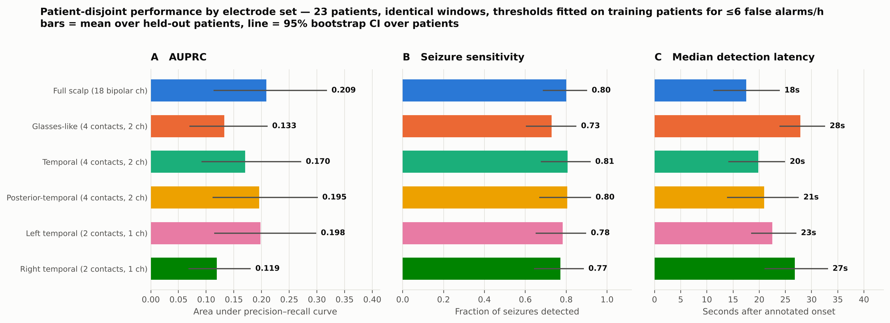
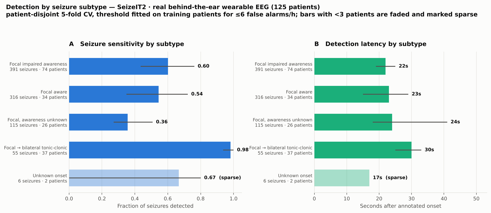

# FORGE — Wearable EEG Benchmark

How much seizure-detection performance is lost when a full scalp EEG montage is
cut down to the handful of contacts that would fit in smart glasses or an
around-ear wearable — and does that depend on the seizure's type or where in the
brain it starts?

**Full write-up: [REPORT.md](REPORT.md). Notebook:
[`notebooks/forge_wearable_eeg_benchmark.ipynb`](notebooks/forge_wearable_eeg_benchmark.ipynb).**

| | Primary objective | Secondary objective |
|---|---|---|
| Question | What does reducing electrode count and moving placement cost? | Does detection depend on seizure type and anatomical onset? |
| Dataset | CHB-MIT — scalp positions as *proxies* for a wearable | SeizeIT2 — a *real* behind-the-ear device |
| Status | Complete (23 patients, 198 seizures, 973 h) | Complete, exploratory (125 patients, 883 seizures, 3 062 h) |
| Planned | — | TUH/TUSZ: does the full-vs-wearable gap depend on seizure type? |

> **The two EEG sources are never pooled.** CHB-MIT gives scalp-position proxies
> for a wearable; SeizeIT2 gives real behind-the-ear hardware with no paired
> full-scalp recording. They are reported separately and never plotted on shared
> axes.

Every configuration is evaluated on **the same recordings, the same 10-second
windows and the same annotations**, so nothing in the comparison is confounded
by recording conditions. Validation is **patient-disjoint**.

Datasets:
[CHB-MIT](https://physionet.org/content/chbmit/1.0.0/) (24 cases, 23 people,
198 seizures) and
[SeizeIT2](https://openneuro.org/datasets/ds005873) (OpenNeuro `ds005873`,
125 patients, 883 focal seizures, behind-the-ear wearable EEG).

## What is actually being compared

CHB-MIT channels such as `F7-T7` are **bipolar differences between two physical
electrodes**, not independent channels. A four-contact wearable mock-up
therefore yields **two bipolar channels**, and a two-contact one yields a single
bipolar channel.

| Configuration | Electrode contacts | Bipolar channels |
|---|---|---|
| Full scalp | 19 | 18 |
| Glasses-like | Fp1, F7, Fp2, F8 | `FP1-F7`, `FP2-F8` |
| Temporal | F7, T7, F8, T8 | `F7-T7`, `F8-T8` |
| Posterior-temporal | T7, P7, T8, P8 | `T7-P7`, `T8-P8` |
| Lower-temporal | T7, FT9, FT10, T8 | `T7-FT9`, `FT10-T8` |
| Two-contact (left / right) | F7, T7 *or* F8, T8 | one channel |

These are **scalp-position proxies**, not recordings from real earbud or glasses
hardware. Real devices differ in contact material, skin coupling, reference
placement, motion artefact and amplifier noise. The lower-temporal pair is the
closest scalp analogue of a behind-the-ear placement, and FT9/FT10 are absent
from three subjects (chb15, chb18, chb19).

## Results

Full write-up, with every number regenerated from the result tables:
**[REPORT.md](REPORT.md)** (CHB-MIT-only summary: [RESULTS.md](RESULTS.md)).

### Primary — electrode reduction and placement (CHB-MIT, scalp proxies)

Across 23 patients, 198 seizures and 973 hours, a **two-channel temporal or
posterior-temporal set is not measurably worse than the full 18-channel
montage** — the paired per-patient AUPRC difference has a confidence interval
straddling zero, and at a matched *achieved* alarm rate the reduced sets are
slightly ahead. The **glasses-like frontal placement is measurably worse**
(−0.076 [−0.154, −0.002]). Against all 153 two-channel subsets of the standard
derivations, posterior-temporal lands at the 88th percentile and glasses-like at
the 14th: *where* a few contacts go matters as much as how many there are.
Single-channel results are asymmetric (left `F7-T7` beats right `F8-T8` in 16 of
23 patients), which argues for a bilateral four-contact layout. The spread
between patients dwarfs the spread between electrode sets.



**One important caveat on that headline.** The comparison is model-dependent.
Under shrinkage LDA the best two-channel set is *ahead* of the full montage by
0.032 AUPRC; under gradient boosting the full montage is ahead by 0.038, because
the extra channels are worth more to a model able to exploit them. "Not
measurably worse than full scalp" is a statement about this linear benchmark,
not about wearable EEG in general.

### Secondary — seizure type and anatomical onset (SeizeIT2, real wearable)

On real behind-the-ear hardware (125 patients, 883 focal seizures, 3 062 h), the
same pipeline detects **506/883 seizures (57 %) at a 6 FA/h target, median
latency 23 s**. Two exploratory findings:

* **Seizure type matters enormously.** Focal-to-bilateral tonic-clonic seizures
  are detected at 0.98 versus 0.54 for focal aware seizures — a paired
  difference of +0.438 [+0.266, +0.641]. The seizures a wearable catches most
  reliably are the ones least likely to go unnoticed anyway.
* **Temporal involvement helps, weakly.** Seizures whose annotated onset
  involves the temporal lobe are detected better than those that do not
  (+0.17 [+0.01, +0.31] on the cleanest subset: localisation annotated,
  focal-to-bilateral excluded). Strict temporal-versus-frontal is **not**
  resolved (+0.11 [−0.10, +0.29]). Sensors were positioned with reference to
  each patient's suspected onset zone, so anatomy and placement are confounded.



An interval that includes zero is not evidence of equivalence — with these
cohort sizes the study cannot resolve differences of the size that would matter
clinically.

## Pipeline

```
# --- CHB-MIT: the electrode-reduction benchmark
scripts/01_inventory.py          # fetch all 24 summaries, parse annotations
scripts/02_download.py           # fetch the EDFs listed in those summaries
scripts/03_extract_features.py   # EDF -> 10 s window features (parallel)
scripts/04_extract_and_prune.py  # same, but deletes each EDF once featurised
scripts/05_figures.py explore    # Fig 1 (needs raw chb01 EDFs)
scripts/06_experiments.py main   # patient-disjoint CV across montages
scripts/06_experiments.py random # placement control over all channel pairs
scripts/06_experiments.py lower  # adds the FT9/FT10 montage where available
scripts/06_experiments.py raw    # ablation: no per-recording normalisation
scripts/06_experiments.py models # classifier check
scripts/07_report.py             # CHB-MIT summary tables + RESULTS.md
scripts/05_figures.py results    # Figs 2-5

# --- SeizeIT2: real wearable, seizure type and anatomical onset
scripts/10_seizeit2_fetch.py metadata          # ~5700 small annotation files
scripts/11_seizeit2_inventory.py               # harmonised annotation tables
scripts/10_seizeit2_fetch.py eeg --with-seizures   # 12.5 GB, not the full 126
scripts/12_seizeit2_features.py                # same features as CHB-MIT
scripts/13_seizeit2_benchmark.py               # subgroup sensitivity + latency
scripts/14_seizeit2_figures.py                 # Figs 5-8

# --- cross-dataset
scripts/16_harmonised_events.py  # one event CSV schema for every dataset
scripts/15_research_report.py    # REPORT.md
scripts/08_build_notebook.py --execute
```

`run_all.sh` chains all of it.

### Signal processing

* 4th-order zero-phase Butterworth band-pass, 0.5–40 Hz.
* Non-overlapping 10 s windows; a window is **ictal** if it overlaps any
  annotated seizure by any amount.
* 14 features per channel: log absolute power and relative power in
  delta/theta/alpha/beta/low-gamma (Welch, 2 s segments, 50 % overlap), log RMS,
  log line length, normalised spectral entropy, and the log fast/slow power
  ratio. A 2-channel montage therefore has 28 features, the full montage 252.
* Features are computed **once for the union of all montages' channels**, so the
  montage design matrices are column slices of one array. Identical windows by
  construction.
* Recordings stored referentially (`chb12_27/28/29`, against CS2) are converted
  back to the bipolar derivations rather than discarded.
* Per-recording robust normalisation (median / IQR) of each feature removes
  amplitude and impedance offsets between recordings. This uses **no labels**,
  but it is non-causal — it models an offline analysis or a device with a long
  calibration baseline, not a strictly online detector. The `raw` experiment is
  the ablation without it.

### Datasets, adapters and the harmonised schema

`seizure_eeg.datasets` gives every corpus one interface
(`recordings()`, `events()`, `load_signals()`, `montages()`,
`label_availability()`), and `seizure_eeg.schema` defines one event/recording
CSV layout for all of them. Two rules shape it:

* **Raw labels survive.** Every harmonised field keeps the source dataset's own
  string beside it in a `*_raw` column.
* **Missing is not a category.** `unknown` (the dataset says so) and
  `not_annotated` (the dataset has no such field) are different facts and are
  never pooled; `*_provenance` records which applies.

| Field | CHB-MIT | SeizeIT2 | TUSZ (planned) |
|---|---|---|---|
| seizure type | not annotated | annotated | annotated |
| onset lobe | not annotated | annotated | not annotated |
| onset hemisphere | not annotated | annotated | not annotated |
| vigilance | not annotated | annotated | not annotated |
| channel-level annotation | not annotated | not annotated | annotated |
| paired full-scalp EEG | annotated | **not annotated** | annotated |

CHB-MIT ships onset and offset times only. Anatomical origin is **not** inferred
from which channels carry the most power or the largest classifier weight —
that would manufacture a clinical label from a signal statistic and make the
subgroup analysis circular. `chbmit.load_external_annotations` accepts a
published table instead, and rejects any row without a citation.

### Classifier and validation

* Shrinkage LDA (`lsqr`, Ledoit-Wolf shrinkage) on standardised features.
* 5-fold `GroupKFold` over **patients**. chb01 and chb21 are the same person and
  are kept in one group, so folds are 23 people, not 24 cases.
* Decision thresholds are chosen on **out-of-fold scores from the training
  patients only** and applied unchanged to the held-out patients.

### Endpoints

Window-level F1 is not reported as a headline number. The endpoints are:

* **AUPRC** (threshold-free, the right summary at ~0.3 % positive prevalence).
* **Event-level seizure sensitivity** — a seizure counts as detected if an alarm
  overlaps `[onset − 30 s, offset + 60 s]`.
* **False alarms per hour**, measured over interictal time. An alarm needs 2
  consecutive windows above threshold, and a sustained alarm is re-issued every
  60 s — otherwise a detector stuck permanently in alarm would score one false
  alarm per recording and near-perfect sensitivity.
* **Detection latency** from annotated onset, clipped at −30 s.
* All of these at matched false-alarm budgets (1, 6 and 24 alarms/hour), because
  comparing untuned thresholds across configurations is not meaningful.
* Confidence intervals are percentile bootstraps **over patients**, not windows.

## Reproducing

```bash
pip install -r requirements.txt
```

```bash
python scripts/01_inventory.py && python scripts/02_download.py
```

```bash
python scripts/04_extract_and_prune.py --keep chb01
```

```bash
python scripts/06_experiments.py main && python scripts/07_report.py
```

The full database is ~43 GB of EDF. `04_extract_and_prune.py` deletes each
subject's recordings once its features are written, so peak disk use stays near
the size of the largest subject. Features for all 24 subjects are a few hundred
MB.

## Data and results layout

```
data/chbmit/chbXX/chbXX-summary.txt   annotations (committed; EDFs are not)
results/features/chbXX.npz            (n_windows, n_channels, 14) float32
results/tables/*.csv                  inventories, CV results, summaries
results/figures/*.png                 figures
```

## Caveats

* CHB-MIT is paediatric and from one centre; these are scalp proxies for
  wearables, so the numbers bound what the *scalp positions* carry, not what a
  real device would achieve.
* The task is **ictal vs non-ictal classification**, not seizure prediction.
* CHB-MIT carries no seizure-onset-localisation labels, so the "do around-ear
  contacts do better for temporal-lobe seizures?" question cannot be answered
  here. Left-vs-right 2-contact performance per patient is reported as the
  nearest available proxy; SeizeIT2 has the localisation metadata needed for the
  real analysis.
* SeizeIT2's public release contains the behind-the-ear wearable signals and
  clinical annotations, but **not** paired full-scalp EEG, so it cannot be used
  for a same-recording electrode ablation — only as external validation of
  whether real wearable hardware detects seizures at all.

## References

* Shoeb & Guttag. *Application of machine learning to epileptic seizure
  detection.* ICML 2010. (CHB-MIT)
* Bhagubai et al. *SeizeIT2: a multimodal wearable dataset of behind-the-ear
  EEG.* Scientific Data, 2025.
* Dan et al. *SzCORE: a seizure community open-source research evaluation
  framework.* 2024.
