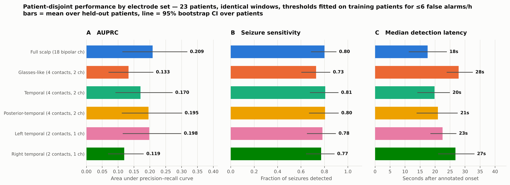
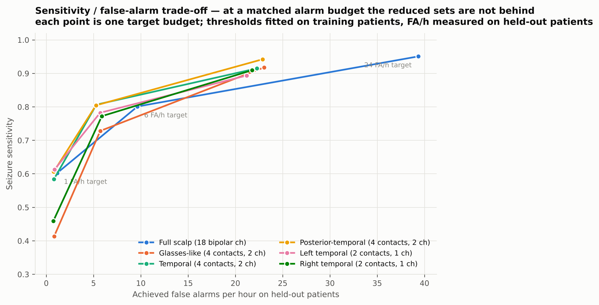
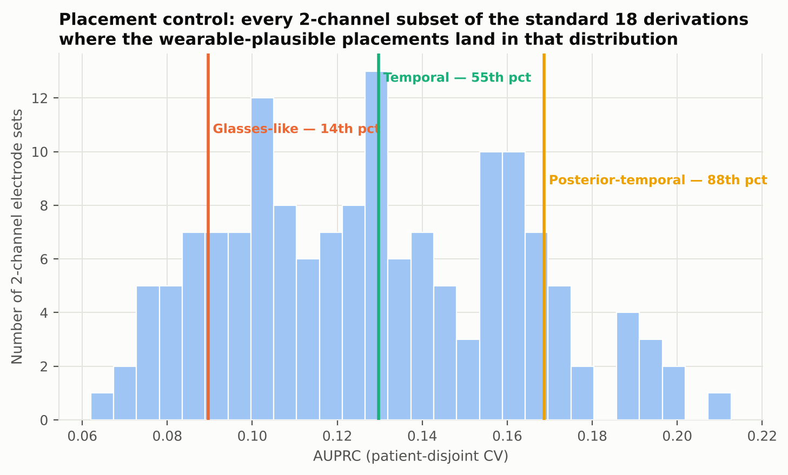
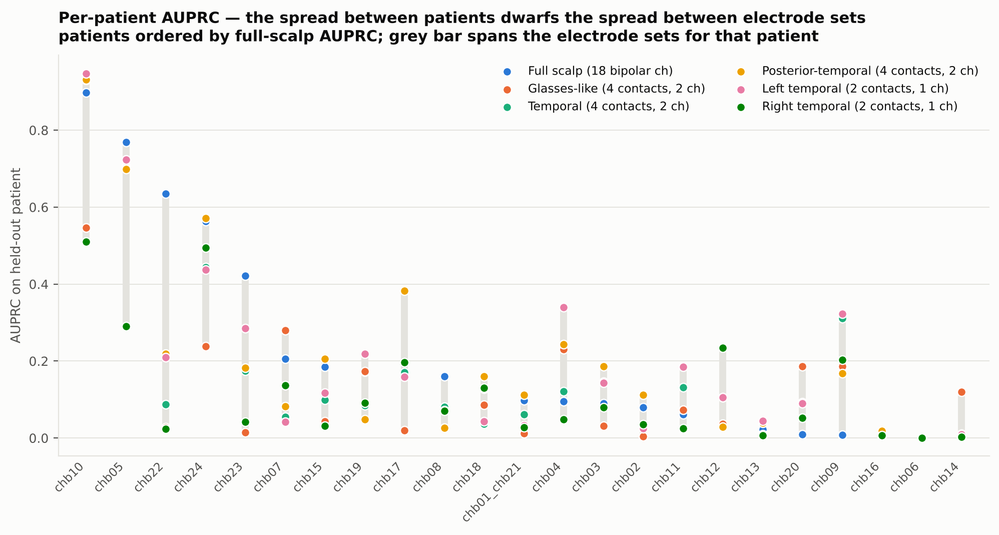
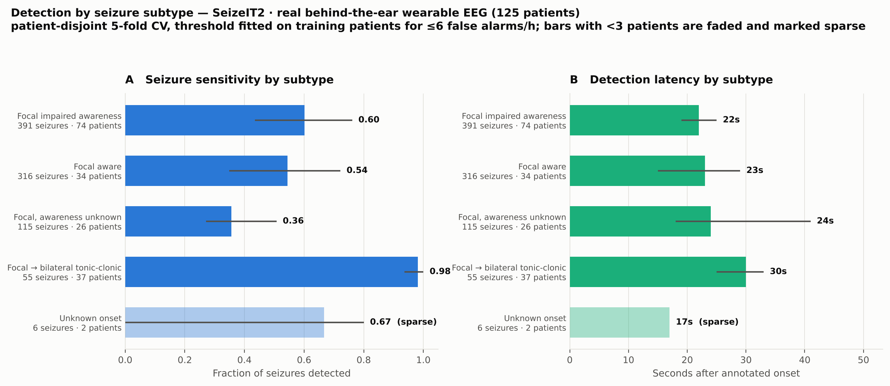
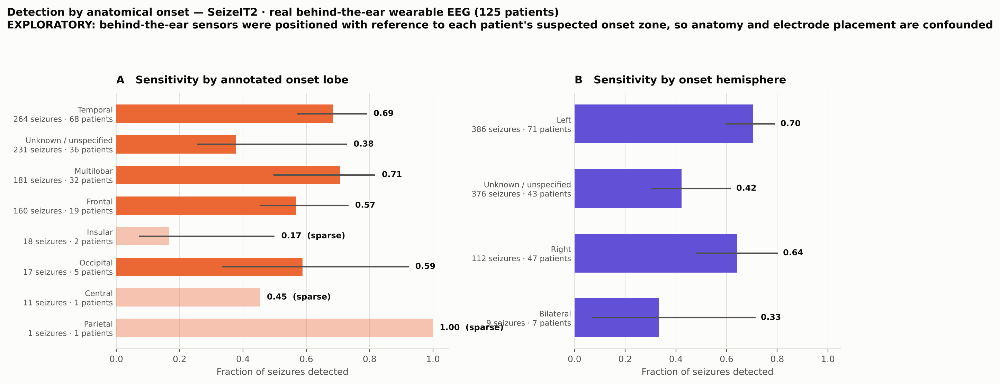
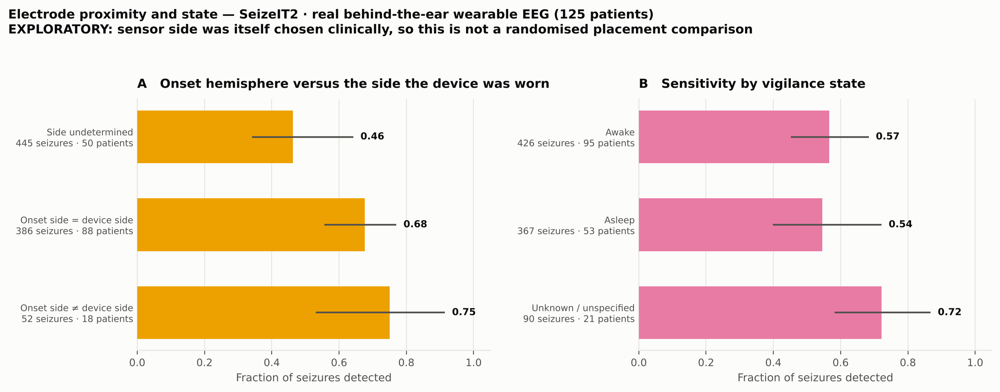

# FORGE — Wearable EEG Benchmark

**Seizure detection with reduced, wearable-compatible electrode configurations, and an exploratory analysis of how seizure type and anatomical onset location affect it.**

Every number in this report is generated by `scripts/15_research_report.py` from the CSV tables in `results/tables/`. Analyses that have not been executed are marked as planned, never reported as results.

## 1. Objective and clinical significance

Continuous EEG is the only direct measure of seizure activity, but a clinical montage is not something a person can wear through an ordinary day. If a handful of contacts hidden in glasses or an around-ear device retained most of the detection performance of a full scalp montage, unobtrusive long-term monitoring and automated caregiver alerting would become practical.

**Primary objective.** Quantify what is lost when a full 18-channel scalp montage is reduced to wearable-sized electrode sets, holding the recording, preprocessing, features, model and evaluation fixed so that only the electrode configuration changes.

**Secondary objective (exploratory).** Ask whether detection with wearable-compatible electrodes depends on seizure type, on the anatomical onset location, and on where the device sits relative to the onset hemisphere. The hypothesis under test is that around-ear contacts are more sensitive to seizures arising nearby — in the temporal lobe — than to distant ones. This is treated throughout as a hypothesis, not a conclusion.

## 2. Datasets and methodology

### 2.1 Datasets

| Dataset | Role | Signals | Patients | Seizures | Recorded | Clinical labels |
|---|---|---|---:|---:|---:|---|
| CHB-MIT | Primary full-versus-reduced benchmark | Scalp EEG, 18 bipolar channels | 23 | 198 | 973 h | onset/offset times only |
| SeizeIT2 | Real-wearable validation, subtype/onset analysis | **Behind-the-ear wearable**, 2 channels | 125 | 883 | 3 062 h analysed | type, onset lobe, hemisphere, vigilance |
| TUH (TUSZ) | Planned: does the full-versus-wearable gap depend on seizure type? | Scalp EEG | — | — | — | seizure-type codes; no validated onset lobe |

> **The two EEG sources are not interchangeable.** CHB-MIT supplies *scalp-position proxies* for a wearable — real electrodes, but on the scalp, with clinical amplifiers and references. SeizeIT2 supplies a *real* behind-the-ear device. Results from the two are reported separately and are never plotted on shared axes.

### 2.2 Electrode configurations (CHB-MIT)

A bipolar EEG channel is the difference between two physical contacts, so a four-contact wearable mock-up yields **two** channels, not four.

| Configuration | Physical contacts | Bipolar channels | Derivations |
|---|---:|---:|---|
| Full scalp (18 bipolar ch) | 19 | 18 | `FP1-F7`, `F7-T7`, `T7-P7`, `P7-O1`, `FP1-F3`, `F3-C3`, `C3-P3`, `P3-O1`, `FP2-F4`, `F4-C4`, `C4-P4`, `P4-O2`, `FP2-F8`, `F8-T8`, `T8-P8`, `P8-O2`, `FZ-CZ`, `CZ-PZ` |
| Glasses-like (4 contacts, 2 ch) | 4 | 2 | `FP1-F7`, `FP2-F8` |
| Temporal (4 contacts, 2 ch) | 4 | 2 | `F7-T7`, `F8-T8` |
| Posterior-temporal (4 contacts, 2 ch) | 4 | 2 | `T7-P7`, `T8-P8` |
| Lower-temporal (4 contacts, 2 ch) | 4 | 2 | `T7-FT9`, `FT10-T8` |
| Left temporal (2 contacts, 1 ch) | 2 | 1 | `F7-T7` |
| Right temporal (2 contacts, 1 ch) | 2 | 1 | `F8-T8` |

### 2.3 Shared pipeline

Identical across datasets and across every montage compared:

* 4th-order zero-phase Butterworth band-pass, 0.5–40 Hz; per-window quality check rejecting non-finite and flat-lined channels.
* Non-overlapping 10 s windows; a window is ictal if it overlaps an annotated seizure at all.
* 14 features per channel: log absolute and relative power in delta/theta/alpha/beta/low-gamma (Welch, 2 s segments, 50 % overlap), log RMS, log line length, normalised spectral entropy, log fast/slow power ratio.
* Robust per-recording scaling (median / IQR) of each feature. This uses no labels, but it is non-causal — see §6.3.
* Shrinkage LDA (`lsqr`, Ledoit–Wolf) on standardised features; the scaler is fitted on training data only.
* 5-fold `GroupKFold` over **patients**, fixed seed. CHB-MIT cases chb01 and chb21 are the same person and share a group.

For the CHB-MIT montage comparison, features are computed once for the union of every montage's channels, so each montage's design matrix is a column slice of one array — the configurations are compared on byte-identical windows by construction.

### 2.4 Alarms, and what counts as a detection

* An alarm requires **2 consecutive** windows above threshold and is raised at the **end** of the second one, because a causal detector cannot report a window it has not finished observing. Latency is measured from that moment, not from the start of a window that happens to overlap a seizure.
* A sustained alarm is re-issued every 60 s. Without this, a detector stuck permanently in alarm would score one false alarm per recording and near-perfect sensitivity.
* A seizure counts as detected if an alarm overlaps `[onset − 30 s, offset + 60 s]`; latency is clipped at −30 s so an already-running alarm cannot earn unbounded negative credit.
* False alarms are counted per alarm event over interictal time.
* Decision thresholds are chosen from **out-of-fold scores on the training patients only**, at matched budgets of 1, 6 and 24 false alarms per hour, then applied unchanged to held-out patients.
* Confidence intervals are percentile bootstraps over **patients**.

This is an **offline retrospective** evaluation: the band-pass is zero-phase and the per-recording scaling uses the whole recording. A truly causal real-time detector would use a forward filter and a running baseline, and would not be expected to reproduce these numbers exactly.

## 3. Electrode-count analysis (CHB-MIT)

Patient-disjoint 5-fold CV, thresholds fitted on training patients for ≤6 false alarms/h.

| Configuration | Contacts | Bipolar ch | Features | AUPRC | Sensitivity | Achieved FA/h | Latency (s) | Detected | Seizures |
|---|---|---|---|---|---|---|---|---|---|
| Full scalp (18 bipolar ch) | 19 | 18 | 252 | 0.209 | 0.8 | 9.6 | 18.0 | 142 | 198 |
| Glasses-like (4 contacts, 2 ch) | 4 | 2 | 28 | 0.133 | 0.73 | 5.7 | 28.0 | 118 | 198 |
| Temporal (4 contacts, 2 ch) | 4 | 2 | 28 | 0.17 | 0.81 | 5.3 | 20.0 | 136 | 198 |
| Posterior-temporal (4 contacts, 2 ch) | 4 | 2 | 28 | 0.195 | 0.8 | 5.3 | 21.0 | 142 | 198 |
| Left temporal (2 contacts, 1 ch) | 2 | 1 | 14 | 0.198 | 0.78 | 5.7 | 23.0 | 134 | 198 |
| Right temporal (2 contacts, 1 ch) | 2 | 1 | 14 | 0.119 | 0.77 | 5.9 | 27.0 | 138 | 198 |

Collapsed by physical contact count:

| Contacts | Mean AUPRC | Mean sensitivity |
|---:|---:|---:|
| 19 | 0.209 | 0.80 |
| 4 | 0.166 | 0.78 |
| 2 | 0.159 | 0.78 |

Performance does **not** fall monotonically with electrode count. The 19-contact montage reaches AUPRC 0.209, but the best 4-contact and 2-contact sets are within the bootstrap interval of it (§6). With a linear model and patient-disjoint folds, the 252-feature full montage has more parameters to fit than the cross-patient signal supports.

## 4. Electrode-placement analysis (CHB-MIT)

All of these configurations use the same number of contacts, so any difference is placement, not count. Values are paired per-patient differences in AUPRC against the full montage.

| Configuration | Patients | Δ AUPRC | CI low | CI high | Better in | Worse in |
|---|---|---|---|---|---|---|
| Left temporal (2 contacts, 1 ch) | 23 | -0.011 | -0.069 | 0.045 | 11 | 12 |
| Posterior-temporal (4 contacts, 2 ch) | 23 | -0.013 | -0.069 | 0.036 | 14 | 9 |
| Temporal (4 contacts, 2 ch) | 23 | -0.039 | -0.102 | 0.019 | 11 | 12 |
| Glasses-like (4 contacts, 2 ch) | 23 | -0.076 | -0.154 | -0.002 | 9 | 14 |
| Right temporal (2 contacts, 1 ch) | 23 | -0.09 | -0.172 | -0.015 | 7 | 16 |

Configurations whose interval excludes zero (measurably worse than full scalp): Glasses-like (4 contacts, 2 ch), Right temporal (2 contacts, 1 ch).

Configurations whose interval includes zero: Left temporal (2 contacts, 1 ch), Posterior-temporal (4 contacts, 2 ch), Temporal (4 contacts, 2 ch). **An interval that includes zero is not evidence of equivalence** — it means this cohort cannot resolve a difference, and the intervals are wide.

### 4.1 Single-channel placements are not symmetric

Comparing the two one-channel detectors on the same patients, left `F7-T7` minus right `F8-T8` AUPRC is +0.079 [+0.022, +0.143], with the left favoured in 16/23 patients. For a one-sided device the side matters, which argues for a bilateral four-contact layout over a unilateral two-contact one.

### 4.2 The closest scalp analogue of a behind-the-ear device

`T7-FT9` and `FT10-T8` need the FT9/FT10 contacts, which only some recordings carry, so this is a separate paired run on the subset where every configuration is available. It detects 142/181 seizures at 6.1 FA/h with a median latency of 18 s — the same seizure count as the full montage (142/181) at 9.6 FA/h, though its AUPRC (0.133) is clearly lower than the full montage's (0.202).

At a **matched achieved** alarm rate the reduced sets are not behind the full montage. Part of the full montage's advantage in the table above is that its thresholds transfer less well across patients, so it spends a larger alarm budget than it was tuned for.

## 5. Random-electrode controls (CHB-MIT)

Every one of the 153 valid two-channel subsets of the 18 standard bipolar derivations was scored with the same patient-disjoint cross-validation. This places the wearable-plausible layouts on a percentile rather than only against each other.

* Best pair overall: `T7-P7+FZ-CZ` (AUPRC 0.213)
* Median over all pairs: 0.127; worst: 0.062
* Temporal (`F7-T7+F8-T8`): AUPRC 0.130 — 55th percentile
* Glasses-like (`FP1-F7+FP2-F8`): AUPRC 0.090 — 14th percentile
* Posterior-temporal (`T7-P7+T8-P8`): AUPRC 0.169 — 88th percentile

The wearable-plausible placements are not the best available two-channel sets, and the spread across placements is comparable to the gap between a two-channel set and the full montage. Where a small number of contacts can be put matters as much as how many there are.

## 6. Uncertainty and robustness

### 6.1 Between-patient spread dominates

Per-patient AUPRC ranges from 0.001 to 0.794 across 23 patients. That spread is far larger than any difference between electrode configurations, so a patient-general detector is limited more by cross-patient variability than by electrode count.

### 6.2 Threshold transfer

Thresholds fitted on training patients do not land on the same alarm rate in held-out patients:

| Configuration | Target FA/h | Achieved FA/h |
|---|---:|---:|
| Full scalp (18 bipolar ch) | 1 | 1.2 |
| Full scalp (18 bipolar ch) | 6 | 9.2 |
| Full scalp (18 bipolar ch) | 24 | 37.6 |
| Glasses-like (4 contacts, 2 ch) | 1 | 0.8 |
| Glasses-like (4 contacts, 2 ch) | 6 | 5.7 |
| Glasses-like (4 contacts, 2 ch) | 24 | 22.6 |
| Left temporal (2 contacts, 1 ch) | 1 | 1.0 |
| Left temporal (2 contacts, 1 ch) | 6 | 5.8 |
| Left temporal (2 contacts, 1 ch) | 24 | 20.8 |
| Posterior-temporal (4 contacts, 2 ch) | 1 | 0.8 |
| Posterior-temporal (4 contacts, 2 ch) | 6 | 5.4 |
| Posterior-temporal (4 contacts, 2 ch) | 24 | 22.7 |
| Right temporal (2 contacts, 1 ch) | 1 | 0.8 |
| Right temporal (2 contacts, 1 ch) | 6 | 6.1 |
| Right temporal (2 contacts, 1 ch) | 24 | 21.9 |
| Temporal (4 contacts, 2 ch) | 1 | 0.9 |
| Temporal (4 contacts, 2 ch) | 6 | 5.6 |
| Temporal (4 contacts, 2 ch) | 24 | 22.1 |

### 6.3 Ablation: per-recording normalisation

Robust per-recording feature scaling is label-free but non-causal. Removing it is the single largest effect measured in this project — larger than any electrode choice:

| Configuration | With scaling | Without | Change |
|---|---:|---:|---:|
| Full scalp (18 bipolar ch) | 0.137 | 0.105 | -0.032 |
| Glasses-like (4 contacts, 2 ch) | 0.090 | 0.028 | -0.062 |
| Left temporal (2 contacts, 1 ch) | 0.171 | 0.047 | -0.124 |
| Posterior-temporal (4 contacts, 2 ch) | 0.169 | 0.059 | -0.109 |
| Right temporal (2 contacts, 1 ch) | 0.060 | 0.029 | -0.032 |
| Temporal (4 contacts, 2 ch) | 0.130 | 0.050 | -0.080 |

A real device would need an equivalent online calibration (a running baseline) to approach these numbers.

### 6.4 Classifier check

_Gradient-boosting comparison not completed in this run; the shrinkage-LDA results above stand on their own, and whether a non-linear model changes the electrode ranking is still open._

## 7. Exploratory seizure-type analysis (SeizeIT2)

**This section uses real behind-the-ear wearable EEG, not a scalp proxy.** The public SeizeIT2 release contains no paired full-scalp recording, so nothing here is a full-versus-wearable comparison; it is external validation of what a real two-channel around-ear device achieves, broken down by seizure type.

Patient-disjoint 5-fold CV over 125 held-out patients, 883 annotated seizures, 395 recordings, same pipeline as CHB-MIT. Overall at the ≤6 FA/h target: **506/883 seizures detected (57.3%)**, median latency 23 s, mean AUPRC 0.042 at a prevalence of 0.54 %.

| Seizure type | Seizures | Patients | Detected | Sensitivity | CI low | CI high | Latency (s) |
|---|---|---|---|---|---|---|---|
| Focal impaired awareness | 391 | 74 | 235 | 0.601 | 0.435 | 0.761 | 22.0 |
| Focal aware | 316 | 34 | 172 | 0.544 | 0.349 | 0.722 | 23.0 |
| Focal, awareness unknown | 115 | 26 | 41 | 0.357 | 0.271 | 0.507 | 24.0 |
| Focal → bilateral tonic-clonic | 55 | 37 | 54 | 0.982 | 0.936 | 1.0 | 30.0 |
| Unknown onset | 6 | 2 | 4 | 0.667 | 0.0 | 0.8 | 17.0 |

Focal-to-bilateral tonic-clonic seizures are detected far more reliably than focal aware seizures: 0.98 versus 0.54, a paired difference of +0.438 [+0.266, +0.641]. This is the clearest subgroup effect in the project and it is the expected direction: a bilateral convulsive seizure produces large, widespread, high-amplitude change that two channels anywhere on the head will see, while a focal aware seizure may not reach the surface near the sensor at all.

Clinically this cuts both ways. The seizures a wearable detects most reliably are the ones most likely to be noticed without it; the subtle ones that would most benefit from automated detection are the ones it misses.

## 8. Exploratory anatomical onset analysis (SeizeIT2)

> **Read this section as hypothesis-generating only.** SeizeIT2 behind-the-ear sensors were positioned with reference to each patient's suspected seizure-onset zone. Differences in detection between anatomical subgroups are therefore confounded with electrode placement and must not be read as a pure effect of onset location.

Unknown and multilobar onsets are kept as their own groups. Folding them into whichever lobe is listed first would manufacture precision the annotations do not have.

### 8.1 By annotated onset lobe

| Onset lobe | Seizures | Patients | Sensitivity | CI low | CI high | Latency (s) |
|---|---|---|---|---|---|---|
| Temporal | 264 | 68 | 0.686 | 0.571 | 0.791 | 24.0 |
| Unknown / unspecified | 231 | 36 | 0.377 | 0.254 | 0.728 | 23.0 |
| Multilobar | 181 | 32 | 0.707 | 0.496 | 0.818 | 29.0 |
| Frontal | 160 | 19 | 0.569 | 0.453 | 0.733 | 16.0 |
| Insular | 18 | 2 | 0.167 | 0.071 | 0.5 | 21.0 |
| Occipital | 17 | 5 | 0.588 | 0.333 | 0.923 | 25.0 |
| Central | 11 | 1 | 0.455 |  |  | 24.0 |
| Parietal | 1 | 1 | 1.0 |  |  | 52.0 |

### 8.2 Is the temporal-lobe hypothesis supported?

The hypothesis is that around-ear contacts are more sensitive to nearby (temporal) onsets. Four contrasts, progressively removing confounds:

| Grouping | Subset | Comparison | n A | n B | Sens A | Sens B | Δ | CI low | CI high |
|---|---|---|---|---|---|---|---|---|---|
| Onset lobe | all seizures | temporal - frontal | 264 | 160 | 0.686 | 0.569 | 0.117 | -0.08 | 0.276 |
| Temporal lobe involved? | all seizures | temporal involved − not involved | 403 | 480 | 0.707 | 0.46 | 0.247 | 0.049 | 0.387 |
| Temporal lobe involved? | localisation annotated only | temporal involved − not involved | 403 | 249 | 0.707 | 0.538 | 0.169 | 0.002 | 0.295 |
| Temporal lobe involved? | excluding focal-to-bilateral | temporal involved − not involved | 376 | 452 | 0.689 | 0.427 | 0.262 | 0.058 | 0.404 |
| Temporal lobe involved? | localisation annotated, excluding focal-to-bilateral | temporal involved − not involved | 376 | 239 | 0.689 | 0.519 | 0.17 | 0.008 | 0.308 |
| Onset lobe | localisation annotated, excluding focal-to-bilateral | temporal - frontal | 247 | 155 | 0.668 | 0.555 | 0.113 | -0.102 | 0.285 |

Two cautions on reading these. First, `involves_temporal == False` pools genuinely non-temporal onsets with seizures whose localisation was never annotated — different facts — which is why the localisation-annotated rows are reported separately. Second, focal-to-bilateral seizures are detected almost perfectly (§7) and are not evenly distributed across lobes, so the rows excluding them isolate the anatomical question from the seizure-type one.

On the cleanest subset — localisation annotated, focal-to-bilateral excluded:

| Onset lobe | Seizures | Patients | Sensitivity | CI low | CI high |
|---|---|---|---|---|---|
| Temporal | 247 | 60 | 0.668 | 0.552 | 0.778 |
| Multilobar | 168 | 28 | 0.685 | 0.435 | 0.809 |
| Frontal | 155 | 16 | 0.555 | 0.44 | 0.716 |
| Insular | 17 | 2 | 0.118 | 0.0 | 0.5 |
| Occipital | 17 | 5 | 0.588 | 0.333 | 0.923 |
| Central | 11 | 1 | 0.455 |  |  |

### 8.3 Hemisphere, and the side the device was worn

| Onset hemisphere | Seizures | Patients | Sensitivity | CI low | CI high |
|---|---|---|---|---|---|
| Left | 386 | 71 | 0.705 | 0.595 | 0.792 |
| Unknown / unspecified | 376 | 43 | 0.423 | 0.303 | 0.618 |
| Right | 112 | 47 | 0.643 | 0.478 | 0.802 |
| Bilateral | 9 | 7 | 0.333 | 0.067 | 0.714 |

| Onset side vs device side | Seizures | Patients | Sensitivity | CI low | CI high | Latency (s) |
|---|---|---|---|---|---|---|
| Side undetermined | 445 | 50 | 0.463 | 0.341 | 0.643 | 21.0 |
| Onset side = device side | 386 | 88 | 0.676 | 0.556 | 0.77 | 25.0 |
| Onset side ≠ device side | 52 | 18 | 0.75 | 0.531 | 0.915 | 31.0 |

Wearing the device on the side of the onset hemisphere did **not** measurably improve detection: ipsilateral 0.68 versus contralateral 0.75, Δ -0.074 [-0.265, +0.163]. The contralateral group is small (52 seizures in 18 patients) and the comparison is not randomised — clinicians chose the side — so this is weak evidence either way, not a demonstration that side does not matter.

### 8.4 What CHB-MIT can and cannot contribute here

CHB-MIT ships seizure onset and offset times and nothing else: no validated seizure type, no onset lobe, no hemisphere. Those fields are therefore recorded as `not_annotated` and the anatomical analysis is deferred to SeizeIT2 and TUH. Inferring onset location from which channels carry the most power or the largest classifier weight would manufacture a clinical label out of a signal statistic and make the subsequent analysis circular, so it is not done. `seizure_eeg.datasets.chbmit.load_external_annotations` accepts a published annotation table if one becomes available, and rejects any row without a citation.

## 9. Limitations

1. **Simulated versus real wearables.** The CHB-MIT configurations are scalp-position proxies. Contact material, skin coupling, reference placement, motion artefact and amplifier noise all differ in a real device. The two datasets' results are never pooled.
2. **No paired comparison in SeizeIT2.** The public release has no simultaneous full-scalp recording, so the full-versus-wearable question cannot be answered there at all.
3. **Placement confound.** SeizeIT2 sensors were positioned with reference to the suspected onset zone, so anatomy and placement are entangled in every subgroup in §8.
4. **Overlapping intervals are not equivalence.** Several reduced configurations have confidence intervals that include zero difference from full scalp. With 23 patients the study cannot resolve differences of the size that would matter clinically; that is a limit of power, not a demonstration of equivalence.
5. **Offline, not causal.** Zero-phase filtering and whole-recording normalisation are retrospective. §6.3 shows the normalisation is worth more than any electrode choice, so an online equivalent is a prerequisite, not a detail.
6. **Cohorts.** CHB-MIT is paediatric and single-centre. All SeizeIT2 participants have focal epilepsy, so no focal-versus-generalised comparison is possible.
7. **Selected recordings in SeizeIT2.** Only recordings containing at least one annotated seizure were analysed (3 062 h of the full corpus). False-alarm rates are therefore measured on that subset, not on the whole monitoring period.
8. **Subgroup sizes.** Several anatomical subgroups rest on a handful of patients; those rows are marked sparse in the figures and should be read as descriptive.

## 10. Next steps for TUH integration

The eventual TUSZ analysis combines both objectives: **does the gap between full-scalp and wearable-inspired configurations depend on seizure type?** TUSZ is the only one of the three corpora that can answer it, because it has both full-scalp EEG and clinical seizure-type codes.

`seizure_eeg.datasets.tuh` is a skeleton. `TUSZAdapter.IMPLEMENTED` is `False` and every data method raises until a real corpus is mounted, so no TUH number can be reported by accident.

### 10.1 Seizure-code mapping plan

| TUSZ code | Harmonised type | Counted as seizure |
|---|---|---|
| fnsz | Focal, unspecified | True |
| spsz | Focal aware | True |
| cpsz | Focal impaired awareness | True |
| gnsz | Generalized | True |
| absz | Generalized | True |
| tnsz | Generalized | True |
| cnsz | Generalized | True |
| atsz | Generalized | True |
| mysz | Generalized | True |
| tcsz | Unclassified | True |
| seiz | Unclassified | True |
| nesz | EXCLUDED (non-epileptic) | False |
| bckg | background | False |

Decisions to re-check against the `_DOCS` of the exact corpus version before any analysis:

* `tcsz` (tonic-clonic) is **not** split by TUSZ into generalized onset versus focal-to-bilateral. It maps to `unclassified` rather than being merged into `generalized`; promote it only if the version in hand distinguishes them. Given §7, mis-assigning these would distort the subtype analysis more than any other single choice.
* `nesz` marks non-epileptic events. These must be excluded from the seizure counts *and* from the interictal background used for false-alarm rates.
* Background must be read from the term files (`bckg`), not assumed to be anything unmarked.

### 10.2 Two rules that must survive integration

1. **A seizure-type code is not an anatomical onset label.** `cpsz` means focal with impaired awareness; it says nothing about lobe. `onset_lobe` stays `not_annotated` for TUSZ unless a clinical localisation is supplied from EEG reports or a separate validated table.
2. **Channel-level annotations are not localisation.** TUSZ marks which channels an event was seen on. That is an electrographic field, shaped by montage and propagation. Mapping "seen on T3-T5" to "temporal onset" is the inference forbidden in §8.4.

### 10.3 Montage mapping

TUSZ uses the older 10-20 labels T3/T4/T5/T6 where CHB-MIT uses T7/T8/P7/P8; `TUSZ_ELECTRODE_ALIASES` records the correspondence and `TUSZ_MONTAGES` already expresses the wearable configurations in TUSZ's own labels, so the electrode-reduction analysis transfers without redefinition.

### 10.4 Work order

1. Obtain TUSZ under its data-use agreement; mount at `data/tusz/`.
2. Implement term-file parsing, verify `TUSZ_TYPE_MAP` against the shipped docs, set `IMPLEMENTED = True`.
3. Re-run the electrode-reduction benchmark unchanged on TUSZ.
4. Stratify the full-minus-reduced difference by seizure type — the analysis this project exists to make possible (planned figure 8).
5. Only if validated localisations are obtainable, extend §8 to TUSZ.

## Appendix: tables and figures

All CSVs are in `results/tables/`; figures in `results/figures/`. Harmonised event tables follow `seizure_eeg.schema`.

| Figure | Content | Dataset |
|---|---|---|
| 1 | One seizure through each electrode set | CHB-MIT (scalp proxy) |
| 2 | AUPRC, sensitivity, latency by electrode set | CHB-MIT |
| 3 | Sensitivity versus achieved false-alarm rate | CHB-MIT |
| 4 | All 153 two-channel subsets as a placement control | CHB-MIT |
| 5 | Per-patient spread | CHB-MIT |
| 5b | Sensitivity and latency by seizure subtype | SeizeIT2 (real wearable) |
| 6 | Sensitivity by onset lobe and hemisphere | SeizeIT2 |
| 7 | Onset side versus device side; vigilance | SeizeIT2 |
| 8 | Annotation inventory | SeizeIT2 |
| — | Electrode layout × seizure type | **planned, needs TUH** |

### References

* Shoeb & Guttag. *Application of machine learning to epileptic seizure detection.* ICML 2010. (CHB-MIT)
* Bhagubai et al. *SeizeIT2: a multimodal wearable dataset.* Scientific Data, 2025. OpenNeuro ds005873.
* Dan et al. *SzCORE: a seizure community open-source research evaluation framework.* 2024.
* Obeid & Picone. *The Temple University Hospital EEG Data Corpus.* Frontiers in Neuroscience, 2016. (TUSZ)

