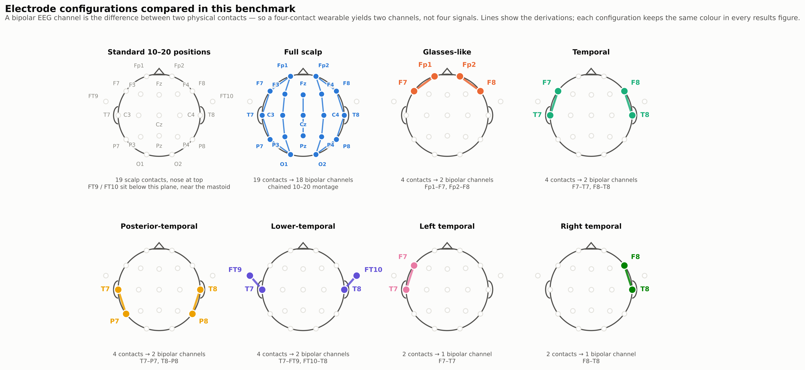

# Seizure detection with wearable-compatible electrode configurations

## Objective

Continuous EEG is the only direct measure of seizure activity, but a clinical
montage cannot be worn through an ordinary day. We asked how much
seizure-detection performance is lost when a full 18-channel scalp montage is
reduced to the few contacts that would fit in smart glasses or an around-ear
device — and, secondarily, whether that loss depends on the seizure's type or
where in the brain it begins.

Two datasets were used, and their results are reported separately throughout.
**CHB-MIT** (23 patients, 198 seizures, 973 h) provides full scalp EEG from
which reduced configurations are carved out, so configurations can be compared
on byte-identical windows; its wearable layouts are *scalp-position proxies*,
not real devices. **SeizeIT2** (125 patients, 883 focal seizures, 3,062 h
analysed) provides *real* two-channel behind-the-ear recordings with clinical
annotations for seizure subtype, onset lobe, hemisphere and vigilance, but no
paired full-scalp recording — so it supports external validation of real
wearable hardware, never a full-versus-wearable comparison.

A bipolar EEG channel is the difference between two physical contacts, so a
four-contact wearable mock-up yields **two** channels, not four. Contact count
and channel count are reported separately throughout. Figure 0 shows where each
configuration sits on the scalp.

## Methods

Identical across datasets and across every configuration compared: 0.5–40 Hz
zero-phase Butterworth band-pass; non-overlapping 10 s windows; 14 features per
channel (absolute and relative band power in delta/theta/alpha/beta/low-gamma,
RMS, line length, spectral entropy, fast/slow ratio); robust per-recording
feature scaling; shrinkage LDA with the scaler fitted on training data only;
5-fold GroupKFold over **patients** with a fixed seed. CHB-MIT cases chb01 and
chb21 are the same person and share a cross-validation group.

An alarm requires two consecutive windows above threshold and is raised at the
*end* of the second, because a causal detector cannot report a window it has not
finished observing; latency is measured from that moment. A sustained alarm is
re-issued every 60 s, so a detector stuck permanently in alarm is penalised
rather than rewarded. A seizure counts as detected if an alarm overlaps
[onset − 30 s, offset + 60 s]. Decision thresholds are fitted on out-of-fold
scores from **training patients only** at matched budgets of 1, 6 and 24 false
alarms per hour, then applied unchanged to held-out patients. Confidence
intervals are percentile bootstraps over patients. The evaluation is offline and
retrospective, not a causal real-time algorithm.

## Electrode count and placement (CHB-MIT)

At a ≤6 FA/h training budget, patient-disjoint. AUPRC is the mean over held-out
patients; "detected" pools all 198 seizures.

| Configuration | Contacts | Channels | AUPRC [95% CI] | Sensitivity | Achieved FA/h | Latency | Detected |
|---|---:|---:|---|---:|---:|---:|---:|
| Full scalp | 19 | 18 | 0.209 [0.113–0.318] | 0.80 | 9.6 | 18 s | 142/198 |
| Posterior-temporal (T7-P7, T8-P8) | 4 | 2 | 0.195 [0.112–0.301] | 0.80 | 5.3 | 21 s | 142/198 |
| Left temporal (F7-T7) | 2 | 1 | 0.198 [0.114–0.299] | 0.78 | 5.7 | 23 s | 134/198 |
| Temporal (F7-T7, F8-T8) | 4 | 2 | 0.170 [0.091–0.272] | 0.81 | 5.3 | 20 s | 136/198 |
| Glasses-like (Fp1-F7, Fp2-F8) | 4 | 2 | 0.133 [0.069–0.211] | 0.73 | 5.7 | 28 s | 118/198 |
| Right temporal (F8-T8) | 2 | 1 | 0.119 [0.068–0.181] | 0.77 | 5.9 | 27 s | 138/198 |

Performance does **not** fall monotonically with electrode count. As a paired
per-patient difference in AUPRC against the full montage, the glasses-like
layout (−0.076 [−0.154, −0.002]) and the right-temporal single channel
(−0.090 [−0.172, −0.015]) are measurably worse; temporal (−0.039
[−0.102, +0.019]), posterior-temporal (−0.013 [−0.069, +0.036]) and
left-temporal (−0.011 [−0.069, +0.045]) have intervals that include zero. An
interval including zero is **not** evidence of equivalence — with 23 patients the
study cannot resolve differences of the size that would matter clinically.

The full montage's apparent sensitivity advantage is partly bought with alarms:
it produced 9.6 FA/h against a 6 FA/h target, versus 5.3–5.9 for the reduced
sets, because its thresholds transfer less well across patients. Plotted against
*achieved* alarm rate, the reduced sets are not behind.

Placement matters as much as count. Single-channel results are asymmetric: left
F7-T7 beats right F8-T8 by +0.079 AUPRC [+0.022, +0.143], favoured in 16 of 23
patients — so for a one-sided device the side matters, which argues for a
bilateral four-contact layout. The lower-temporal pair (T7-FT9, FT10-T8), the
closest scalp analogue of a behind-the-ear device, detected the same 142/181
seizures as the full montage on the subset where it is available, at 6.1 FA/h
versus 9.6, though its AUPRC was clearly lower.

## Random-electrode control (CHB-MIT)

All 153 valid two-channel subsets of the standard 18 derivations were scored
identically. Best pair overall: T7-P7 + FZ-CZ (AUPRC 0.213); median 0.127; worst
0.062. The wearable-plausible layouts land at the **88th percentile**
(posterior-temporal, 0.169), **55th** (temporal, 0.130) and **14th**
(glasses-like, 0.090). None is the best available two-channel set, and the
spread across placements is comparable to the gap between two channels and the
full montage.

## Seizure type and anatomical onset (SeizeIT2, exploratory)

On real behind-the-ear hardware the same pipeline detected **506/883 seizures
(57%) at a ≤6 FA/h target, median latency 23 s** across 125 patient-disjoint
subjects (AUPRC 0.042 against a 0.0054 chance baseline, ≈8× chance; absolute
AUPRC is low because seizures are rare).

| Seizure subtype | Seizures | Patients | Sensitivity [95% CI] | Latency |
|---|---:|---:|---|---:|
| Focal → bilateral tonic-clonic | 55 | 37 | 0.98 [0.94–1.00] | 30 s |
| Focal impaired awareness | 391 | 74 | 0.60 [0.44–0.76] | 22 s |
| Focal aware | 316 | 34 | 0.54 [0.35–0.72] | 23 s |
| Focal, awareness unknown | 115 | 26 | 0.36 [0.27–0.51] | 24 s |

**Seizure type dominates every other factor measured.** Focal-to-bilateral
tonic-clonic seizures are detected at 0.98 versus 0.54 for focal aware seizures,
a paired difference of **+0.438 [+0.266, +0.641]**. This cuts both ways
clinically: the seizures a wearable catches most reliably are the ones least
likely to go unnoticed, while the subtle seizures that would most benefit from
automated detection are the ones it misses.

By annotated onset lobe: temporal 0.69 (264 seizures, 68 patients), multilobar
0.71 (181, 32), frontal 0.57 (160, 19), unknown 0.38 (231, 36). Seizures whose
onset **involves** the temporal lobe are detected better than those that do not:
+0.247 [+0.049, +0.387] over all seizures, and +0.170 [+0.008, +0.308] on the
cleanest subset (localisation annotated, focal-to-bilateral excluded). Strict
temporal-versus-frontal is **not** resolved (+0.113 [−0.102, +0.285]).

Two confounds were removed explicitly rather than left implicit. "Does not
involve temporal" otherwise pools genuinely non-temporal onsets with seizures
whose localisation was never annotated — different facts. And
focal-to-bilateral seizures are detected almost perfectly and are not evenly
distributed across lobes. The temporal effect survives both.

Wearing the device on the side of the onset hemisphere did **not** measurably
help (ipsilateral 0.68 versus contralateral 0.75, Δ −0.074 [−0.265, +0.163]),
but the contralateral group is small and the side was chosen clinically, not
randomised. Vigilance made no measurable difference (asleep 0.55 versus awake
0.57, Δ −0.021 [−0.145, +0.122]).

**Crucially, SeizeIT2's behind-the-ear sensors were positioned with reference to
each patient's suspected onset zone, so anatomy and electrode placement are
confounded.** Every anatomical result above is hypothesis-generating.

## Robustness

Two results temper the headline.

**The comparison is model-dependent.** Under shrinkage LDA the best reduced
configuration is 0.032 AUPRC *ahead* of the full montage; under gradient
boosting the full montage is 0.038 *ahead* (full 0.137 → 0.217; temporal
0.130 → 0.180; posterior-temporal 0.169 → 0.119). Extra channels are worth more
to a model able to exploit them. "Not measurably worse than full scalp" is a
statement about this linear benchmark, not about wearable EEG in general.

**Per-recording normalisation matters more than any electrode choice.** Removing
it drops event sensitivity from 0.72 to 0.32 for the temporal configuration and
from 0.74 to 0.48 for the full montage. A real device would need an equivalent
online calibration; this is a prerequisite, not a detail.

Between-patient spread dwarfs between-configuration spread: per-patient AUPRC
ranges from 0.001 to 0.794. A patient-general wearable detector is limited far
more by cross-patient variability than by electrode count.

## Limitations

CHB-MIT configurations are scalp-position proxies — contact material, skin
coupling, reference placement, motion artefact and amplifier noise all differ in
a real device, and the two datasets' results are never pooled. SeizeIT2 has no
paired full-scalp recording, so the full-versus-wearable question cannot be
answered there at all, and its sensors were placed by suspected onset zone.
Overlapping confidence intervals are not equivalence. The evaluation is offline,
not causal. CHB-MIT is paediatric and single-centre; all SeizeIT2 participants
have focal epilepsy, so no focal-versus-generalised comparison is possible. Only
SeizeIT2 recordings containing at least one seizure were analysed, so its
false-alarm rates are measured on that subset. Several anatomical subgroups rest
on a handful of patients and are descriptive only.

## Next steps

The analysis neither corpus here can support is whether the **gap** between
full-scalp and wearable-inspired configurations depends on seizure type. That
needs TUH/TUSZ, the only corpus with both full-scalp EEG and clinical
seizure-type codes. A dataset adapter and a documented seizure-code mapping plan
are in place; the adapter refuses to return results until a real corpus is
mounted. Two rules are recorded for that integration: a seizure-type code is not
an anatomical onset label, and channel-level annotations are an electrographic
field shaped by montage and propagation, not a validated onset lobe. The most
immediate follow-up, though, is repeating the paired event-level comparison with
a non-linear model.
